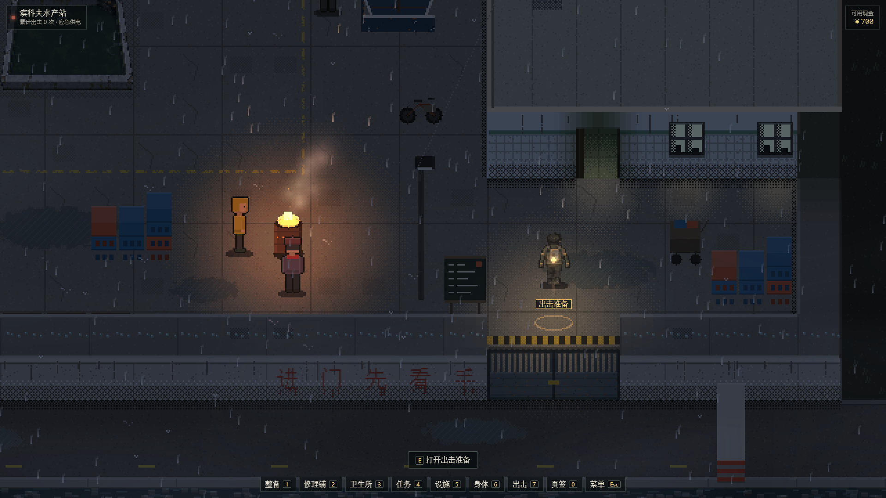
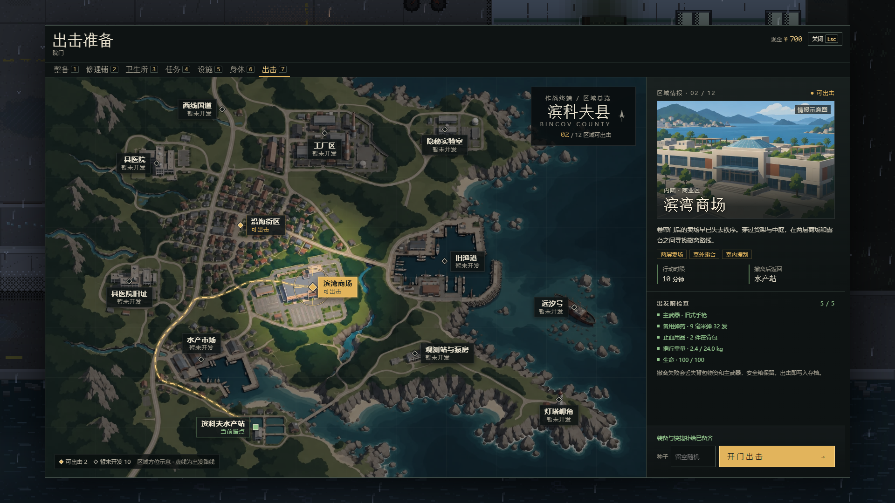
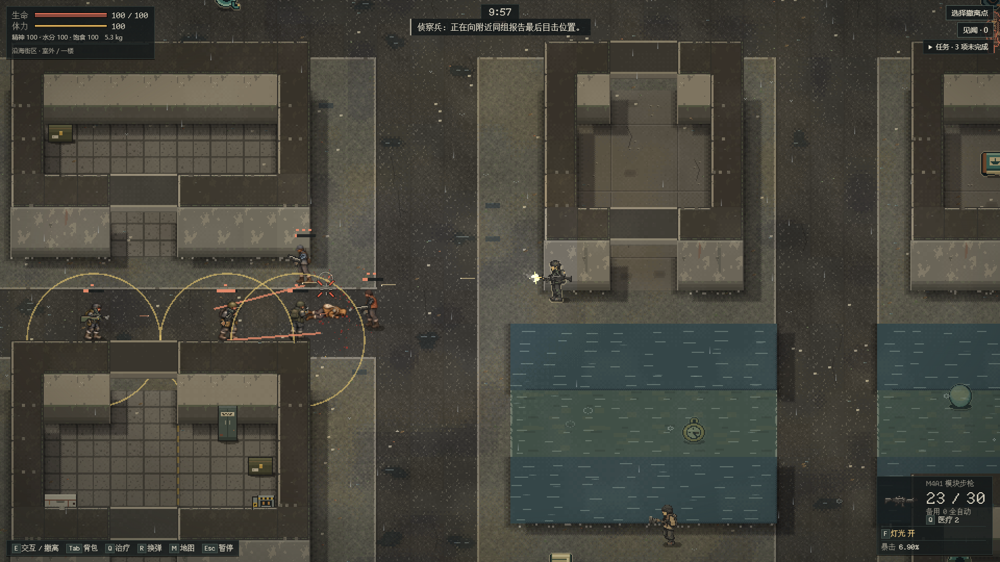
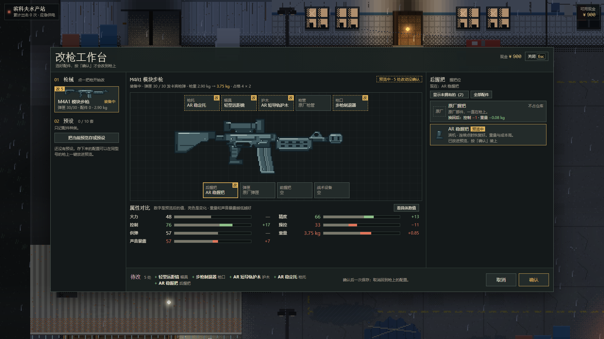
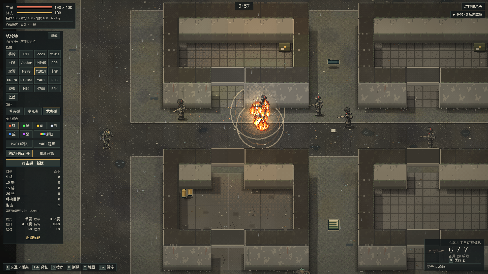
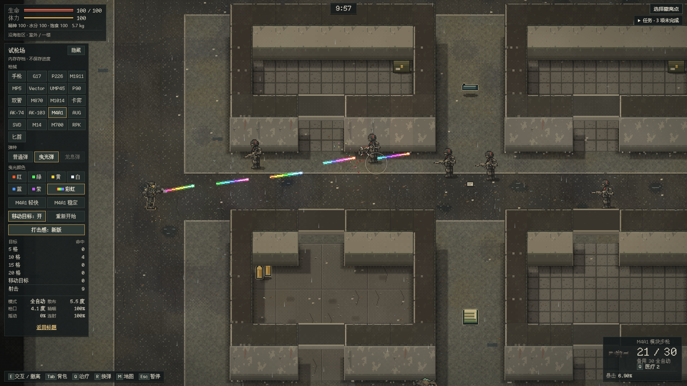

<div align="center">

# 🌊 逃离滨科夫

**E S C A P E  B I N C O V**

**台风过后，海没有退去。带上最后一匣子弹，活着回到水产站。**

[](https://github.com/xuys2025/escape-bincov/actions/workflows/ci-pages.yml)


### [🌊 官网](https://xuys2025.github.io/escape-bincov/) · [▶️ 在线试玩](https://xuys2025.github.io/escape-bincov/play/) · [🎯 试枪场](https://xuys2025.github.io/escape-bincov/play/?range=1) · [📦 下载离线版](https://github.com/xuys2025/escape-bincov/releases/download/main-latest/Escape-Bincov-portable.zip)

<a href="https://xuys2025.github.io/escape-bincov/play/">
  
</a>

<sub>新档实际截图 · 单人撤离生存 · 浏览器直接玩，无需账号 · 单文件离线运行 · 美术仍在补齐</sub>

</div>

## 🎒 回来，才算带走

超强台风和异常赤潮封锁了虚构的滨科夫县。你在县城边的滨科夫水产站落脚，每次出门只有十分钟：搜物资，躲开或打倒拾荒者和更糟的东西，赶在潮水和时间之前撤回来。带回的东西拿去交易、交任务、修设施、改枪，再准备下一趟。

死在外面，背包和手里的枪都留在那里；安全箱里的东西和水手匕首会跟你回来。

游戏是俯视角像素画面，院子和行动都用 2.5D 画面。项目仍在开发，「整备 → 出击 → 搜刮与交战 → 撤离或失败 → 回站」的单人循环已经完整。

> 本页按 **2026-11-03** 的 `main`（[`d441c49`](https://github.com/xuys2025/escape-bincov/commit/d441c491)）核对。包版本号仍是 `0.2.0`；[v0.2.0 公告](docs/releases/v0.2.0.md)是早期版本，之后合入的内容见[更新记录](CHANGELOG.md)。线上版本以最近一次成功的 [CI 与部署](https://github.com/xuys2025/escape-bincov/actions/workflows/ci-pages.yml)为准。

## 🏚️ 现在可以玩什么

| 内容 | 已经能玩的 |
| --- | --- |
| 序幕 | 新档第一次进站前播放开场动画，可暂停、跳过，也能从标题页「序幕」重看。 |
| 水产站院子 | 雨夜院落、进屋揭顶、和居民说话、修复供电；可以走过去，也可以点地面寻路，或用快捷栏直接打开功能。 |
| 整备与交易 | 仓库、背包、安全箱、武器与护符；拖放、旋转、拆分物品。修理铺和卫生所分「购买」「出售」两页，先放进交易单再统一结算。任务要的物品带绿框，凑够以后箱子和货架里的就不再标。 |
| 据点成长 | 电台任务、仓库扩建，休息区、医疗区、训练区、工作台、黑市五项设施（生产、领取、走动训练）；力量、体质、技巧到 15/20/25/30 级各选一项 Perk，共 24 项。 |
| 剧情 | 市场剧情第一段：在电台找小蔡谈话；街区里的冷柜、配电箱和工具柜留着线索，字幕和「见闻」记下你看到、听到的，回站后再决定告诉小蔡什么。 |
| 改枪 | 二十把枪、一百件配件，外加二十件只能定制的「老栓精工」；改枪工作台、配置预设、拆弹匣。敌人手里拿什么枪，打倒后就掉什么枪。 |
| 行动 | 两个区域，枪械与近战，箱子和尸体搜刮（「附近」列表可逐件拾取地上的东西），地图与撤离指引。每局限时 10 分钟，撤离要停稳并按住交互键 3 秒。进楼时挡视线的墙会沉下去，出来再升起。 |
| 射击与手感 | 举枪精瞄；走动、急转和连射会带来晃动、散布和后坐。命中当帧闪白，枪声按枪种区分，暴击有标记，敌人有受击姿态。试枪场里还能试曳光弹和龙息弹。 |
| 敌人 | 十八类敌人，分属拾荒者团伙、潮蚀生物、盐蚀者、雇佣兵、沿海封锁队五方：有的近身扑砍，有的守岗、报信、换弹，有的会跟你上楼；封锁队设卡登记，不一定开枪。 |
| 潮汐与生存 | 行动第 4 分 30 秒预警、第 5 分钟潮位变化；留意污染、流血、水分、饱食与负重。 |
| 存档 | 浏览器本地保存、检查点续局、JSON 导出导入；交易和结算写入失败可以重试，多窗口同时打开有冲突保护。 |

### 🗺️ 出击区域

出击面板是一张县域地图，标着十二个规划区域。现在能去两处，其余十处标「暂未开发」，可以看规划简介和情报插图（插图是概念图，不是关卡截图）。

| 区域 | 内容 | 美术进度 |
| --- | --- | --- |
| 沿海街区 | 街区，以及可进入的居民楼一楼、二楼和地下；新出击带市场剧情的线索点。十八类敌人按种子出现在不同地段。 | 街口一带已精修，其余地方暂用通用画面 |
| 滨湾商场 | 两层商场和露台（布局四版）；没探过的房间是暗的，二层有拾荒小队。 | 家具和地面已换正式素材；外立面、楼梯等仍在补（[#47](https://github.com/xuys2025/escape-bincov/issues/47)） |

原「沿海封锁区」和沿海街区是同一张地图，已经关闭，之后作为新地图重做。之前开始、还没打完的行动仍可从标题页「继续」，同样在 2.5D 画面上打完。



<table>
  <tr>
    <td width="50%"><br><sub>沿海街区交火：M4A1 开灯射击，侦察兵在向同组报位置</sub></td>
    <td width="50%"><br><sub>改枪工作台：五处改动还在预览，按「确认」才装到枪上</sub></td>
  </tr>
  <tr>
    <td><br><sub>试枪场：M1014 龙息弹落地炸开</sub></td>
    <td><br><sub>试枪场：M4A1 彩虹曳光连发</sub></td>
  </tr>
</table>

<sub>2026-11-03 在 `d441c49` 的构建上实拍，1920×1080。院子和县域地图是普通入口的新档画面；交火、改枪台和试枪场用测试接口摆放了人物、枪与配件或读取靶位，画面与正常游玩一致。拍摄方法见[截图说明](docs/readme/README.md)。</sub>

## ▶️ 开始第一局

游戏需要浏览器支持 **WebGL**；不支持时页面只显示提示，不进入游戏，存档不受影响。

**在线：** 用电脑上的 Chrome 或 Edge 打开[官网](https://xuys2025.github.io/escape-bincov/)，点「浏览器里开玩」，或直接打开[游戏页](https://xuys2025.github.io/escape-bincov/play/)。页面加载完以后，不再需要外部素材、账号或服务器。游戏从 2026-10-31 起放在 `play/`；存档按网站保存，换地址不受影响，带游戏参数的旧链接（如 `?sample=village`、`?range=1`）会自动转过去。

**离线：** 下载[便携 ZIP](https://github.com/xuys2025/escape-bincov/releases/download/main-latest/Escape-Bincov-portable.zip)，解压到固定目录，双击 `start the game.html`。它是 `main` 最近一次通过全部检查的构建，每次验证成功后自动更新（[发布页](https://github.com/xuys2025/escape-bincov/releases/tag/main-latest)写着对应提交）。不需要 Node.js，也不用联网；如果打开的是编辑器，右键改用 Chrome 或 Edge 打开。

1. **进站整备**：标题页点「进入」。新档先播序幕，可以点「跳过」或按 `Esc`。进院子后按 `Tab` 打开整备，看看主武器、备用弹药和药品。买来的东西结算后进仓库，要自己放进背包。
2. **选择区域**：走到院门互动，或按 `G` 打开「出击准备」，在地图上选区域后出击。行动种子留空就是随机。
3. **搜刮与交战**：`M` 看地图和撤离点，`E` 拾取或打开箱子、尸体，`Tab` 整理背包。背包、搜刮和地图打开时，时间照样在走。
4. **及时撤离**：到本局开放的撤离区，停稳并按住 `E` 满 3 秒。结算保存成功后自动走回院子，进门弹出本局行动报告。

成功撤离带回所有物资；死亡、超时或放弃会丢掉背包物资和主武器，安全箱里的东西和水手匕首保留。负重上限会随成长等状态变化，以界面显示为准。

### 🎯 先试试枪

打开[试枪场](https://xuys2025.github.io/escape-bincov/play/?range=1)，可以换全部二十把枪（手枪、冲锋枪、霰弹枪、步枪、精确步枪、轻机枪）和匕首，以及 M4A1 的「轻快」「稳定」两套配装，打固定靶和移动靶。弹种可选：

- **曳光弹**：所有枪可用，弹道发亮拖尾，命中迸火花，伤害不变；红、绿、黄、白、蓝、紫六色，另有一路变色的彩虹。
- **龙息弹**：只限霰弹枪。火焰弹丸落地炸开，点燃附近的目标，地上留一小片火；不伤自己。

面板显示命中数、散布、后坐偏移与举枪进度。试枪场用内存里的临时进度，**不读也不改正式存档**，刷新就重置。曳光弹和龙息弹目前只在试枪场能用，还不能带进行动。

本地源码仓库先运行 `pnpm build`，再双击 `试枪场.html`；便携版打开 `start the game.html` 后，在地址末尾加 `?range=1`。

### 🔧 改装枪械

老栓一开始卖旧式手枪、双管、卡宾、G17、P226、M870、MP5、M1911 和基础配件；电台任务推进后陆续上架 UMP45、AK-74、M4A1、AK-103、AUG、RPK。常规配件每次出击换一批。P90、Vector、M1014、SVD、M14、M700 不卖，只能在沿海街区和商场的物资里找，或者从拿着它的敌人身上捡。做完「未归的第七艘船」后，修理铺多一个稀有配件的后期货架。

在整备里点主武器槽或枪详情上的「改装」，或在工作台设施页点「打开改枪」。点枪上的位置挑配件，点配件只改预览，按「确认」才会装上；换小弹匣时多出的子弹放回仓库。常用配置可以存成预设（每种枪最多 10 套），在同型号的枪上一键放进预览。M4A1、AK 这类弹匣让枪多占一行的，可以在弹匣位选「不装弹匣」，枪少占一行，弹匣放进仓库；没装弹匣的枪不能开火，也不能带着出击。

「老栓精工」有 20 件，每件在同位置最好，但买不到也捡不到：做完「未归的第七艘船」、工作台升到 3 级后，在工作台设施页向老栓定制，交一件同位置的普通配件、一份精工件坯（只在头目、队长、班长身上和淹水的地方找得到）和现金，当场拿到。

行动中，枪上装了灯光或激光时按 `F`、`G` 开关（触屏点「设备」）；装了双档瞄具按 `V` 切换远近两档（触屏点「切档」）。精瞄时远距瞄具看得更远，装了脚架的枪站定一会儿就会架稳。价格与收入的平衡仍在调。

### 样板入口（看美术进度用）

普通入口已经是 2.5D 画面。另有两个样板入口：[`?sample=village`](https://xuys2025.github.io/escape-bincov/play/?sample=village) 预选沿海街区，种子留空时挑一个从精修街口出发的种子；[`?sample=mall`](https://xuys2025.github.io/escape-bincov/play/?sample=mall) 预选滨湾商场。两个入口都会把还没精修的地方压暗，并在左上角地点后标「样板外」。本地仓库运行 `pnpm build` 后，可以双击根目录的 `城中村试玩.html` 或 `商场试玩.html`。样板和普通入口在同一网站共用一份存档。

### 保存与迁移

存档保存在当前浏览器里，**没有云存档**。旧存档进院子时会受控升级，保留原有的钱、物品、任务和统计。有进行中的行动时，从最近一次成功写入的检查点恢复，少量没来得及保存的进度可能回退。

换浏览器、网站或本地文件路径前，在院子按 `Esc` 打开菜单，选「导出存档」，再到新入口「导入存档」。导入要确认覆盖，两份进度不会合并。遇到保存失败，按界面提示重试，或先导出备份。

## ⌨️ 操作

### 水产站院子

| 输入 | 动作 |
| --- | --- |
| `W A S D` / 方向键，`Shift` | 移动，按住快走 |
| 左键点地面 / 人物或设施 | 走到那里 / 走近并打开对应功能 |
| `E` / 空格 | 与附近的人物或设施互动 |
| `1`～`7` | 整备、修理铺、卫生所、任务、设施、身体、出击 |
| `Tab` / `J` / `C` / `G` | 整备 / 电台任务 / 身体与成长 / 出击准备 |
| `H` / `F1` | 操作说明 |
| `0` | 切换到旧页签界面；可从那里返回院子 |
| 滚轮 / `+` / `-` | 缩放视野 |
| `Esc` | 关闭面板，或打开菜单；通电动画中可跳过 |

### 行动中

| 输入 | 动作 |
| --- | --- |
| `W A S D` / `Shift` | 移动 / 冲刺；搜刮时按下就离开搜刮界面 |
| 鼠标 / 左键 / 按住右键 | 瞄准 / 攻击 / 逐渐举枪精瞄 |
| `R` / `1` / `2` | 换弹 / 主武器 / 水手匕首 |
| `E` | 拾取、搜刮、开门、检查或阅读；在撤离区内按住 3 秒撤离 |
| 滚轮 | 切换附近的箱子、尸体等目标 |
| `Q` | 使用背包里的绷带或急救包 |
| `Tab` / `M` | 背包 / 地图，都不暂停 |
| `J` | 见闻（市场剧情的行动里） |
| `F` / `G` / `V` | 开关枪灯 / 开关激光 / 切换双档瞄具（装了对应配件时） |
| `Esc` | 关闭面板；没有面板时暂停，点「继续」恢复 |

冲锋枪、突击步枪（MP5、UMP45、P90、Vector、AK-74、AK-103、M4A1、AUG）和 RPK 按住左键连发；手枪、霰弹枪、卡宾枪和精确步枪每次点击一枪。停步、举枪后更准；走动、急转和连续射击会增加晃动、散布或后坐，停火后慢慢恢复。切枪、换层不会马上消掉这些代价，读档后也要重新稳住。

整理库存可以拖放或点选格位；拖动物品时按 `R` 旋转、`Esc` 取消。商店交易单不能旋转，物品放进交易单后仍要点「结算」。第一次进入请先点一下游戏画面来启动声音，音量在院子菜单或局内暂停面板里调。

### 📱 手机触控

院子支持摇杆移动和点击互动，窄屏通过「功能」按钮打开整备、商店等面板。行动中用双摇杆和屏幕按钮，推荐横屏：站定并把瞄准摇杆停在内圈会逐渐举枪，推到外圈开火，单发枪按自身射速重复射击，自动枪持续连发。枪上有灯光或激光时点「设备」，有双档瞄具时点「切档」。库存支持点选物品和格位；改枪工作台在手机上分枪身、配件、属性三页，确认和取消固定在底部。切到后台时行动会暂停，回来点「继续」。

移动端目前验证的主要是 Chromium 的手机视口和触控仿真；iPhone、Android 真机的手感和性能还没有验收。不支持手柄。

## 🚧 当前边界与反馈

- **美术仍在补齐**：院子主要人物、关键道具、城中村首批素材，以及十八类敌人的行走、受击、尸体图已经接入。其余居民、环境和动画仍有占位或画风不一；沿海其余地段的精修、商场建筑补图和院子昼夜变化还没做。
- **内容还不多**：十二个规划区域只开放两个；剧情只有市场第一段，后面的主线节点、人物支线和结局还停在文稿（[#83](https://github.com/xuys2025/escape-bincov/issues/83)、[#84](https://github.com/xuys2025/escape-bincov/issues/84)、[#85](https://github.com/xuys2025/escape-bincov/issues/85)）。曳光弹和龙息弹做成正式物品是第二步，还没开工。
- **数值还没平衡**：改枪的价格与收入、Perk、敌人强度都是提案，等真人试玩再调。
- **长期稳定性仍在验证**：资源释放、行动恢复、交易与结算都有修复和回归，长时间运行的内存验收还没完成，见 [#32](https://github.com/xuys2025/escape-bincov/issues/32) 和 [#60](https://github.com/xuys2025/escape-bincov/issues/60)。
- **自动检查通过不等于真人验收**：真机、实际 GPU 性能、长时间手感与平衡都需要试玩反馈。没有多人联机和云存档。

玩家遇到的问题请补到[玩家反馈 #26](https://github.com/xuys2025/escape-bincov/issues/26)，写明入口、浏览器或设备、操作步骤，最好附截图。开发任务从[统一任务清单](docs/WORK-QUEUE.md)查找，按各 issue / PR 的最新状态接手。

## 🛠️ 本地开发

需要 **Node.js 24** 与 **pnpm 11.19.0**。从最新 `main` 开始：

```bash
git clone https://github.com/xuys2025/escape-bincov.git
cd escape-bincov
npm install --global pnpm@11.19.0
pnpm install --frozen-lockfile
pnpm dev
```

打开 `http://127.0.0.1:4173`，改了源码刷新就会重新构建；样板入口在地址后加 `?sample=village` 或 `?sample=mall`。

| 命令 | 用途 |
| --- | --- |
| `pnpm test` | 领域规则、世界、Runtime、存档与事务单测 |
| `pnpm build` | 严格类型检查，生成 `dist/index.html` 和 `start the game.html`（生成物不入库，下同） |
| `pnpm package` | 构建，并在 `release/` 生成离线 ZIP、网页 ZIP 和发布清单 |
| `pnpm check:ci` | 工程守卫：源码依赖图、生成物不入库、入口文档链接等 |
| `pnpm site` / `pnpm test:site` | 组装 Pages（根目录是官网 `site/`，游戏在 `play/`）并在 `http://127.0.0.1:5180` 预览 / 官网检查；都要先 `pnpm package` |
| `pnpm test:browser` / `pnpm test:save-browser` | 基础浏览器流程 / 存档失败、导入导出与回滚 |
| `pnpm test:station` / `pnpm test:raid-default` | 院子交互 / 普通出击入口与旧行动续玩 |
| `pnpm test:shooting` / `pnpm test:range` | 射击与开火方式 / 试枪场与正式存档隔离 |
| `pnpm test:mobile` / `pnpm test:portable` | 手机视口与触控 / 实际解压离线 ZIP 后启动 |

浏览器检查前先执行 `pnpm package` 和 `pnpm exec playwright install chromium`（本地 Linux 缺系统库时加 `--with-deps`）；已有 Chrome 可以用环境变量 `BINCOV_CHROME` 指定路径，Linux/macOS 的便携包检查还需要 Python 3。改了什么该跑哪些检查，见[按风险选检查](docs/CHECKS.md)；全部命令在 [package.json](package.json)，测试环境见[开发手册](docs/AGENT-HANDBOOK.md)，CI 的浏览器分组与渲染器见 [CI 说明](docs/CI.md)。

## 🤝 协作与发布

本仓库是项目的权威来源，`main` 是已接受的版本。接手先读 [AGENTS.md](AGENTS.md)，从[代码导航](docs/CODEMAP.md)找到任务对应的源码、契约和测试，再核对[任务清单](docs/WORK-QUEUE.md)顶部和相关 PR 的实时状态。[开发手册](docs/AGENT-HANDBOOK.md)按需要的小节读；[handoff.md](handoff.md) 和历史报告只在查证时读。

行动只有一个 Runtime，兼容经典与分层两类存档；界面显示、实时模拟和最近检查点不是同一份状态。改之前先看[架构中的状态边界](docs/ARCHITECTURE.md)，确认权威值和提交入口。

同一交付目标继续用原分支和原 PR，独立任务才另开分支；不覆盖别人的工作，不直接推送 `main`。打包生成的 HTML 和 ZIP 不提交，由 CI 构建。存档兼容、写入失败回滚和单文件离线能力必须保留。

PR 经 CI 验证、维护者确认合并后，`main` 的 CI 成功才会更新 GitHub Pages 和离线下载包。**PR 提交、PR 合并和试玩上线是三个不同状态**，公开试玩以最后一次成功部署为准。托管与存档迁移见[部署手册](docs/DEPLOYMENT.md)和[大陆在线游玩指南](docs/ONLINE-CHINA.md)。

## 📚 文档导航

| 内容 | 入口 |
| --- | --- |
| 游戏规则、物品与搜刮 | [游玩手册](docs/PLAYING.md) · [搜刮说明](docs/LOOTING.md) |
| 市场剧情（第一段已接入，真人试玩待做） | [接入说明](docs/tasks/market-story-core.md) · [市场与回站样板](docs/story/CH01-MARKET-SLICE.md) · [剧情转化方案](docs/NARRATIVE-ADAPTATION-PLAN.md) · [事件与线索登记](docs/story/CONTENT-REGISTER.md) · [#83](https://github.com/xuys2025/escape-bincov/issues/83) |
| 世界观与长线故事（文稿已合入，玩法待做） | [世界与主线](docs/WORLD-REGIONS-STORY.md) · [《等海退去》](docs/MAIN-STORY.md) · [文学改写记录](docs/story/GEMINI-REWRITE-20261014.md) · [后续主线 #84](https://github.com/xuys2025/escape-bincov/issues/84) · [人物与结局 #85](https://github.com/xuys2025/escape-bincov/issues/85) |
| 改枪（M0–M4 已合入，试玩与 M5 验收待做） | [改枪计划](docs/gunsmith/README.md) · [任务与排期](docs/gunsmith/TASKS.md) · [规则](docs/gunsmith/CONTRACTS.md) · [进度 #80](https://github.com/xuys2025/escape-bincov/issues/80) |
| 射击、打击感与特殊弹 | [射击实现与决定](docs/SHOOTING-SYSTEM-REWORK.md) · [曳光弹与龙息弹](docs/tasks/special-rounds.md) · [打击感 #75](https://github.com/xuys2025/escape-bincov/issues/75) |
| 敌人（十八类已接入街区，十二区域待接） | [敌人设定](docs/ENEMY-DESIGN.md) · [街区样板](docs/tasks/enemy-street-encounter.md) · [素材与验收](docs/enemy-art/README.md) · [#78](https://github.com/xuys2025/escape-bincov/issues/78) |
| 成长、暴击与 Perk（已接入，平衡待做） | [RPG 系统](docs/RPG-SYSTEM-DESIGN.md) · [暴击与 Perk 设计](docs/CRITICAL-PERK-DESIGN.md) · [实现契约](docs/tasks/critical-perk-contract.md) · [#77](https://github.com/xuys2025/escape-bincov/issues/77) |
| 地图、区域与建筑 | [县域选图](docs/tasks/county-map-select.md) · [十二地区 #82](https://github.com/xuys2025/escape-bincov/issues/82) · [商场 2.5D](docs/mall-2-5d/README.md) · [室内墙体与视野](docs/INDOOR-WALL-VISIBILITY-PLAN.md) · [建筑逻辑](docs/BUILDING-LOGIC.md) |
| 水产站院子与据点接口 | [院子接线说明](docs/station-yard/README.md) · [HideoutRuntime](docs/hideout-runtime/README.md) |
| 开场动画 | [分镜稿](docs/OPENING-CUTSCENE-SCRIPT.md) · [制作方案](docs/OPENING-CUTSCENE-PLAN.md) · [实际画面](docs/opening-cutscene-p0-20261015/README.md) |
| 官网与 `play/` 入口 | [官网记录](docs/tasks/official-site.md) |
| 技术架构与贡献流程 | [架构](docs/ARCHITECTURE.md) · [代码导航](docs/CODEMAP.md) · [贡献指南](CONTRIBUTING.md) · [任务清单](docs/WORK-QUEUE.md) · [按风险选检查](docs/CHECKS.md) · [CI 说明](docs/CI.md) |
| 历史版本与验收记录 | [更新记录](CHANGELOG.md) · [历史证据归档](docs/IMPLEMENTATION-ARCHIVE.md) · [交接记录](handoff.md) |

设计文档写的是长期目标，不等于已经实现；旧验收报告里的测试数量和结论只适用于它注明的提交。

## 🎨 素材与许可

画面混合使用程序绘制和内嵌的 PNG 素材，其中有 AI 生成、经过整理和校验的角色、道具与场景图片；声音由 Web Audio 合成。游戏运行不依赖外部素材或 CDN。地名、组织、人物与故事都是虚构的。

PixiJS 及其依赖的许可，以及内嵌字体的 OFL 声明，见 [THIRD_PARTY_NOTICES.md](THIRD_PARTY_NOTICES.md)，这些声明也随 HTML 保留。**公开仓库不等于授予了开源许可**；原创源码目前没有另附许可证。

<div align="center">

[🌊 进入滨科夫](https://xuys2025.github.io/escape-bincov/play/) · [官网](https://xuys2025.github.io/escape-bincov/) · [🐛 玩家反馈](https://github.com/xuys2025/escape-bincov/issues/26) · [🔧 开发遗留](https://github.com/xuys2025/escape-bincov/issues/32)

</div>
