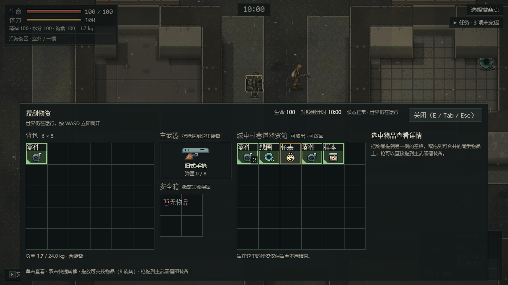
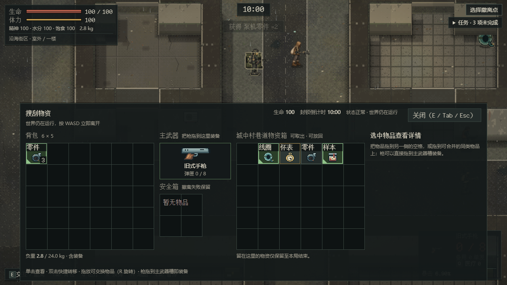
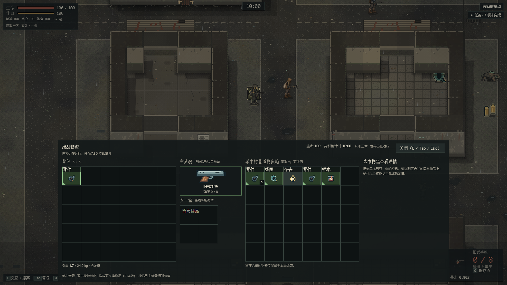
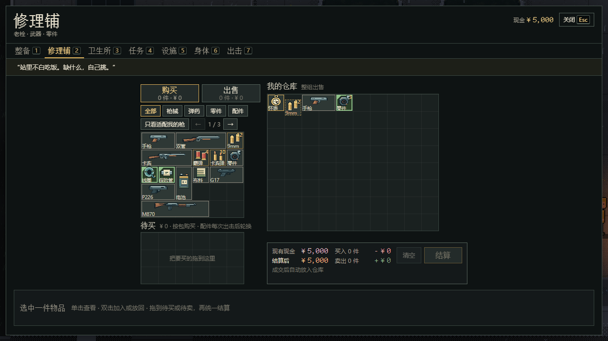
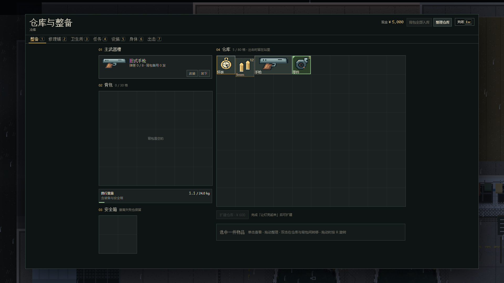
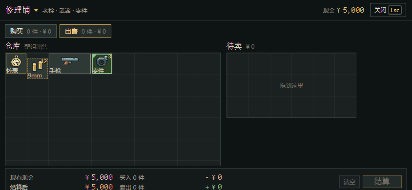

# 任务物品绿框高亮

维护者 2026-11-02 提出：

1. 任务需要的物品要高亮（金边或绿边），提醒玩家。
2. 智能显示：比如某个物品要 3 件，背包里已经有 3 件，外面的就不再标；背包里的照样标。

分支 `feat/quest-item-highlight`，基线 main `33adc85b`（含 #170 前端精致度第二批）。只改显示，存档、任务、交易和搜刮规则都不变。

## 规则

判断写在 [qol.ts](../../src/qol.ts) 的 `questMarks`，行动和院子共用：

| 位置 | 什么时候标 |
| --- | --- |
| 玩家自己的格子：行动里的背包、安全箱；院子的背包、安全箱、仓库、待卖 | 电台任务没交之前一直标 |
| 外面的格子：行动里的物资箱和尸体；院子商人货架、待买 | 只在还没凑够时标。凑够以后外面的变回普通样式，自己身上和仓库里的继续标 |

- “已有多少”和任务卡用同一个数：行动中是仓库加身上（背包和安全箱），在院子里是仓库、背包、安全箱合计。所以仓库里已经放着 3 个零件时，行动里的箱子也不会再标零件。待买栏里的东西结算前不算已有。
- 任务交付后，它要的物品哪里都不再标。
- 现有任务：「让灯亮起来」要 3 个泵机零件、2 卷绝缘线圈、1 支陶瓷保险管；「瓶中的潮声」要赤潮封存样本；「未归的第七艘船」要港口船册。

## 显示

- 用绿色（`--ui-g`），没用金色：游戏里鼠标悬停和选中物品本来就是琥珀金，金边会和这两种状态混在一起。
- 绿色边框加一圈内描边，格子底色带一点绿，角上一个绿色小三角，只看颜色分不清的玩家也能认出来。
- 小三角放在空着的角：行动面板的物品名在上、数量在右下，所以放左下；院子的物品名在下、数量在右上，所以放左上。
- 悬停和选中仍然是琥珀色边框，盖在绿框上面，选中哪个一眼能看出来。
- 鼠标提示和读屏文字后面加“任务需要”。
- 样式在 [tactical.css](../../src/tactical.css)（行动面板用的物品外观）和 [station.css](../../src/station-view/station.css)，颜色都取共用变量。

## 代码入口

- 行动：[coast-view/inventory.ts](../../src/coast-view/inventory.ts) 的 `grid` 读 `InventoryHost.questMarks`，由 [coast-view/host.ts](../../src/coast-view/host.ts) 用当前存档和行动背包提供。没有这个接口时不标（测试里的面板照旧）。
- 院子：[station-view/grid.ts](../../src/station-view/grid.ts) 的 `gridHtml` 多一个 `marks` 选项，商人货架和待买栏按“还缺”标，其他格子按“任务要”标；[panels.ts](../../src/station-view/panels.ts) 的整备和商店传入，商店的 marks 由 [ui.ts](../../src/station-view/ui.ts) 给。
- 旧版页签界面（备用入口）这次没改。

## 检查

- 单测 [qol.test.ts](../../tests/qol.test.ts) 新增 4 项：规则本身（凑够前后、交付后）、行动中按仓库加身上计数、院子格子输出、行动搜刮面板输出（捡够后箱子里的变普通、背包里的仍标）。把两处 `need` 判断改成恒为否时，后两项失败。
- 浏览器 [issue26-raid-inventory-test.mjs](../../scripts/issue26-raid-inventory-test.mjs) 新增 `quest-item-rings`（1280×720、1920×1080，CI batch-2）：真实打开物资箱，检查实际画出的绿框、角标和提示文字，样本的任务类边框也被绿框盖住；双击捡起两个零件凑够 3 个后，箱子里剩下的零件变普通，背包里的继续标，存档与世界同步。
- 浏览器 [shop-feedback-test.mjs](../../scripts/shop-feedback-test.mjs) 新增 `quest rings`（1280×720、1920×1080、844×390，CI batch-5）：仓库已有 3 个零件时，货架上的零件不标、线圈和保险管标；仓库、待卖、整备页里的零件都标；整个过程不写存档。
- 本机 Chrome 实测（构建 `e0cc9552…`）：1122 单测、`pnpm package`、`pnpm check:ci` 139 通过；`test:issue26-inventory` 20/20、`test:shop-feedback` 31、`test:shop-drag` 21/21、`test:loot` 48、`test:ui` 38、`test:qol` 27、`test:issue26-station` 18/18 全部通过。

## 截图

行动，箱子里还缺（1280×720）：零件、线圈、样本标绿，怀表不标。

双击捡起两个零件、凑够 3 个以后：箱子里剩下的零件变普通，背包里的继续标，线圈和样本还缺所以还标。

院子修理铺（1280×720）：仓库已有 3 个零件，货架上的零件不标，线圈和保险管标；右边仓库里的零件标。

整备页（1920×1080）和手机横屏出售页（844×390）：

## 遗留

- 旧版页签界面没加高亮。
- 真人、真机未验。
