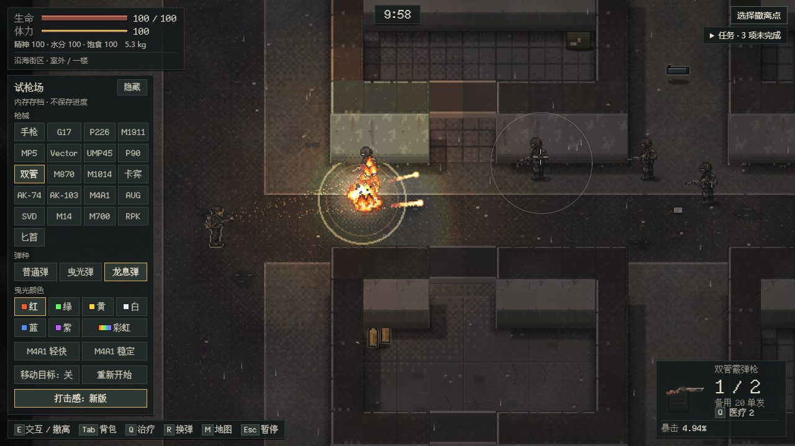
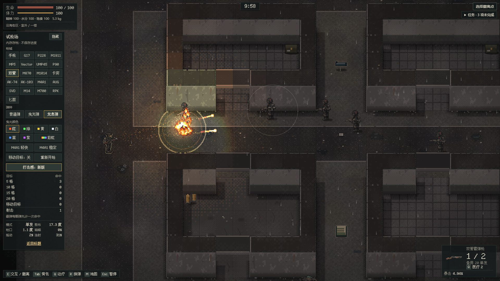
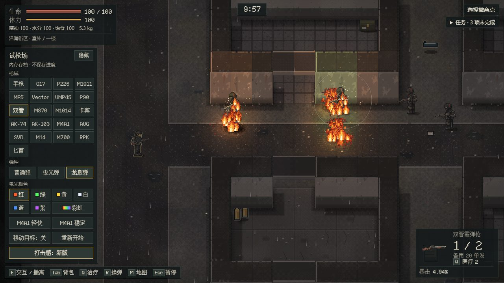
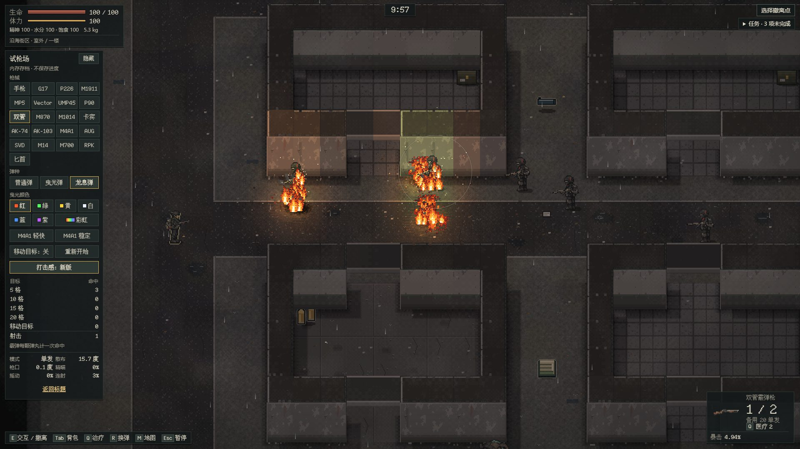
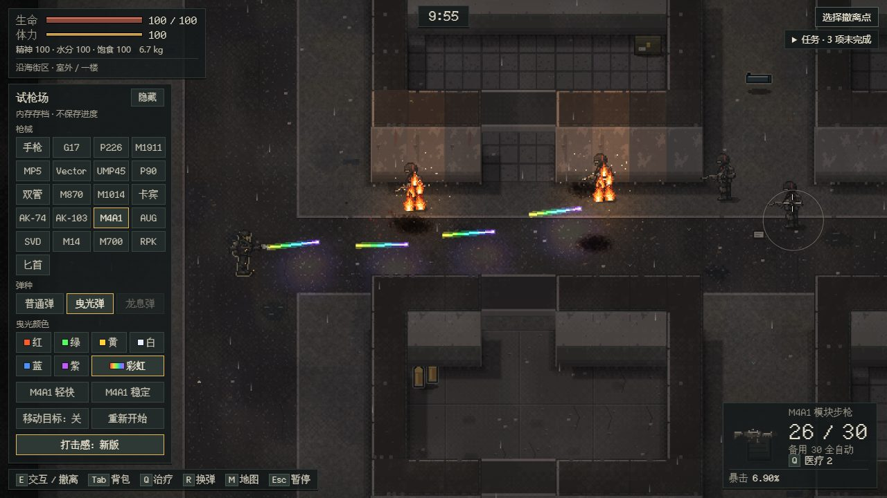
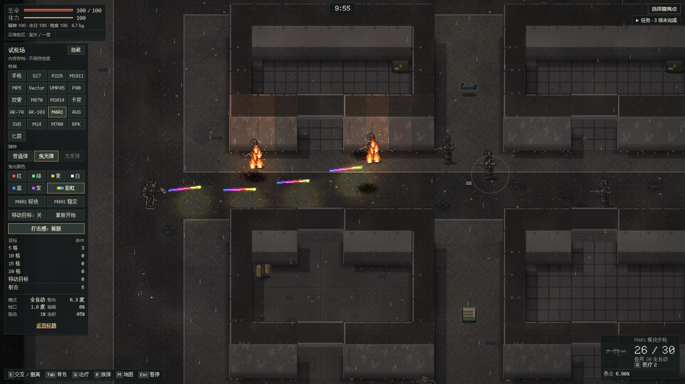
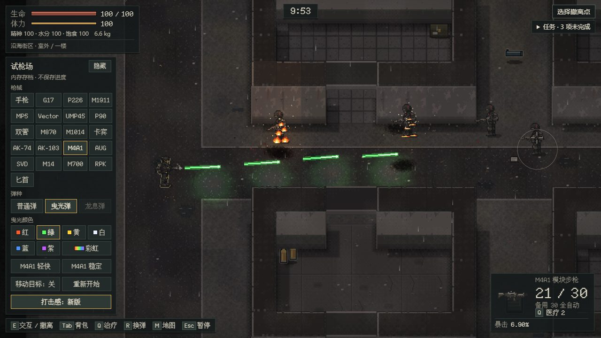
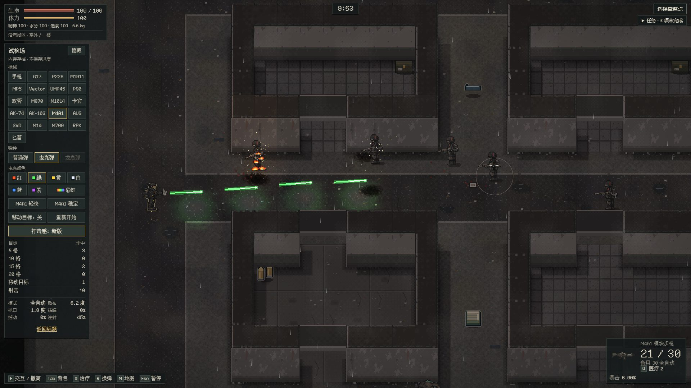

# 曳光弹与龙息弹（第一步：试枪场）

维护者 2026-11-02 提出：“曳光弹、龙息弹 我现在就想要 要炫酷爆炸的那种”。当时游戏里没有弹种：每个弹药组只有一种基础弹（[改枪方案](../gunsmith/PLAN.md) 第 4 节），弹匣只记发数；也没有任何爆炸或着火效果。同日问答定下：

1. **先做到试枪场能打**：两种弹的效果和伤害规则，试枪场面板加“弹种”切换，存档不动。商店、背包、换弹选弹种、弹匣记住弹种（存档版本 +1）放到第二步。
2. **龙息弹**：霰弹枪专用。火焰弹丸落地炸开，点燃附近敌人，地上留一小片火。爆炸和火只伤敌人，不伤玩家。
3. **曳光弹**：六个弹组都有曳光版（所有枪可用）。弹道发亮拖尾，打中的地方迸火花，伤害不变。

维护者在本地试玩后补充（同日）：曳光要有不同颜色的预设，另加彩虹曳光（多色变换）。

分支 `feat/special-ammo`，基线 main `2b3fd7e9`（含 #171）。

## 规则

数值都在 [special-rounds.ts](../../src/special-rounds.ts) 的 `DRAGON`。

| 项目 | 龙息弹 | 对照：普通霰弹 |
| --- | --- | --- |
| 弹丸速度 | 560 像素/秒（看得清火球） | 760 |
| 每颗弹丸直接伤害 | 枪本身弹丸伤害的 0.6 倍（双管 15 → 9） | 15 |
| 落地炸开 | 撞墙、打中人、飞到射程尽头都会炸。中心 34 像素内、视线没被墙挡住的敌人着火，并吃 12 点爆炸伤害；同一枪对同一个敌人只算一次爆炸伤害 | 无 |
| 燃烧 | 每 0.5 秒 4 点，共 3 秒（24 点），无视护甲；再次着火从头计时，不叠加 | 无 |
| 地火 | 每次炸开留一片半径 22 像素的火，烧 2.5 秒；站在火里的敌人一直着火。离已有地火 16 像素内再炸，只把那片火续满 | 无 |
| 玩家 | 爆炸、燃烧、地火都不伤玩家 | — |

- 双管贴脸打一个拾荒者（56 血）：直接 6×9=54，加爆炸 12、燃烧 24，总量和普通霰弹的 90 差不多，但一部分要等火烧完，而且能顺带点燃旁边的人。
- 曳光弹就是枪自己的子弹：速度、伤害、暴击都不变，只是带标记，画面不同。
- 曳光颜色（`TRACER_COLORS`）：红（默认）、绿、黄、白、蓝、紫六个预设，加彩虹。颜色只影响画面，Runtime 的 `tracerColor` 跟 `round` 一样只在内存里，随曳光弹的 shot 事件和飞行中的子弹（`color` 字段）发布；龙息弹和普通弹不带颜色。
- 判断哪把枪能装哪种弹：`roundFits`。曳光弹任何有弹药的枪都行；龙息弹只有用霰弹的枪（双管、M870、M1014）。匕首都不行。
- Runtime 的 `round` 是当前装的特殊弹，只在内存里；枪装不了时照常打普通弹。第一步只有试枪场会设置它，正常行动永远是普通弹。

## 画面与声音

- 龙息弹出膛：枪口喷出一股火焰碎屑，镜头多震一点，街面被照成橙色。弹丸画成小火球拖着三层火尾，沿途掉火星，地面跟着亮。
- 炸开：8 帧像素火球（白热核心 → 黄 → 橙 → 红壳 → 烟），一圈贴地扩散的冲击环，碎石和火星四溅，冒一柱烟，留下焦痕；同时一大一小两盏光照亮附近的墙和地面。一枪几颗弹丸一起落在同一处时合成一个更大的火球，不叠六个。镜头按距离震动、往外推一下；“减少动态效果”时不震不推。
- 地火：每片 9 簇像素火苗（中间大、边上小），地面有橙色光晕，火光闪烁，不时飘火星和烟；最后 0.7 秒火苗矮下去。
- 着火的敌人：身上 5 簇火苗跟着人走，带一盏小火光，往上冒火星；火灭或人死就消失。
- 曳光弹：按所选颜色画一条比普通弹道长约三倍的亮线，外面一圈同色辉光（叠加混合），头部亮点，地面被照成同一种颜色；打中墙或人时闪一个十字火花（白色图按颜色着色）、喷一把同色火星。颜色表在 [fire-fx.ts](../../src/coast-view/fire-fx.ts) 的 `tracerPalette`。
- 彩虹曳光：弹道分成 7 段，从尾到头各差一点色相，整条每秒转约一圈半，每颗子弹起始色相不同，所以连射时一串子弹颜色各不相同、飞行中也在变；照地的光和命中火花取弹头当时的颜色，火星散布在整个色环上。
- 声音（全部合成，不加素材）：龙息弹在霰弹枪声上叠一声火焰呼啸；炸开是低沉的闷响加噪声轰鸣和噼啪尾音（同一枪 0.08 秒、48 像素内的几次炸开只响一次）；地火燃烧时有轻微的噼啪声。
- 未揭示房间里的爆炸、地火和火苗都不画也不响，和其他特效同一规则。

## 不进存档

- 存档、检查点、物品、商店都没改。特殊弹的标记、待炸开的落点、地火和燃烧都是 Runtime 内存里的状态，检查点照常校验通过（单测里飞行中和燃烧中各存过一次）。
- 页面刷新后从检查点恢复时，飞行中的龙息弹变成普通弹丸（速度和伤害仍是龙息弹的），火全部熄灭。换楼层时同样熄灭。第二步做正式物品时再决定要不要存。
- 字体：新增“曳、迸、龙、彩、紫、虹、颜”七个字，按 [字体说明](../../assets/fonts/README.md) 用固定上游文件重新生成了子集（1206 → 1213 字）。

## 试枪场面板

- “枪械”下面新增“弹种”一行：普通弹 / 曳光弹 / 龙息弹。按下的那个就是下一枪打的弹。
- 手里的枪装不了的弹种按钮变灰（例如步枪的龙息弹、匕首的两种特殊弹）。换成装不了当前弹种的枪时自动回到普通弹。
- 再下面是“曳光颜色”：红、绿、黄、白、蓝、紫、彩虹，每个按钮前有色块（彩虹是渐变色块）。点颜色的同时会装上曳光弹（手里的枪能装的话），因为颜色只在曳光弹上看得到。选过的颜色会一直保留，换枪、切回普通弹都不变。
- 命中统计只算子弹打中，爆炸和燃烧不算命中（`RangeStats.hits`）。“重新开始”会熄灭所有火。

## 检查

- 单测 [special-rounds.test.ts](../../tests/special-rounds.test.ts) 8 项：弹种适配；燃烧节奏与重新着火；死亡/离开停止燃烧、地火点燃与熄灭、就近合并；龙息弹实打（速度、直接伤害上限、炸开、燃烧、地火、玩家不受伤、检查点可存、火会烧完）；曳光弹（速度伤害不变、默认红色、无爆炸）；曳光颜色（选彩虹即装曳光弹、事件和子弹带彩虹、龙息弹不带颜色、未知颜色被拒）；普通弹和装不了的弹种不带任何标记、不产生火；试枪场命中不计火、重新开始灭火。
- 浏览器 `test:range` 新增第二个用例：弹种按钮随枪启用/变灰，双管装龙息弹打 5 格靶，等到画面上有爆炸、着火的靶子和地火；换卡宾枪自动回到普通弹，装曳光弹打 10 格靶，等到命中火花；颜色默认红，点彩虹后只有彩虹按下，打 15 格靶时飞行中的子弹是彩虹；最后切回普通弹。

## 第二步（未开工，待维护者排期）

- 物品：六个弹组各一种曳光弹，加龙息弹；价格、老栓货架、搜刮和尸体掉落。曳光颜色是做成不同物品（例如“绿色曳光弹”），还是装填时另选，待定。
- 弹匣记住装的是哪种弹：装备和行动装备加字段，存档版本 +1，旧档按普通弹迁移；换弹时怎么选弹种（按键或背包里拖），一个弹匣能不能混装。
- 检查点要不要存飞行中的特殊弹和地火。
- 平衡：龙息弹伤害、燃烧和护甲的关系；敌人会不会用；曳光弹要不要暴露射手位置。
- Runtime 的经典（非分层）行动路径也接了落地，但只在分层行动（试枪场）里测过。

## 验证（本机 Chrome）

基线 main `2b3fd7e9`，最终构建（含曳光颜色）。2026-11-02 中午同步 main `56650a39`（#168 市场剧情）：冲突只在 import 行、任务清单和字体子集（重新生成为 1239 字）；同步后单测 1143/1143、工程守卫 139/139、`test:range` 3/3、`test:market-view` 12/12 通过。同时修了连射的彩虹曳光颜色几乎相同的问题（子弹编号哈希没打散，`3abe886d`）。

| 检查 | 结果 |
| --- | --- |
| `tsc --noEmit` | 通过 |
| 单测（`pnpm test`） | 1130/1130 通过（新增 8 项） |
| 工程守卫（`pnpm check:ci`） | 139/139 通过 |
| `pnpm package` | 通过：离线单文件 9.14 MB，便携 ZIP 6,133,652 字节 |
| `test:range` | 3/3 通过（含新用例） |
| `test:shooting` | 加颜色前的构建 16/17：k（拥挤战斗的声音预算）失败；用 main `2b3fd7e9` 的构建对照，k 在本机同样连续两次失败，属本机音频环境，以 CI 为准。加颜色只改曳光弹的画法，普通弹道没动 |

截图（黄昏光照 `&mood=1`，试枪场实际运行）：

| | 1280×720 | 1920×1080 |
| --- | --- | --- |
| 龙息弹炸开 |  |  |
| 地火与着火的靶子 |  |  |
| 彩虹曳光 |  |  |
| 绿色曳光 |  |  |

未验：真人手感与平衡、真机（手机触屏上弹种行在面板里要往下滚才看得到）、正常行动（第一步本来就拿不到）。
